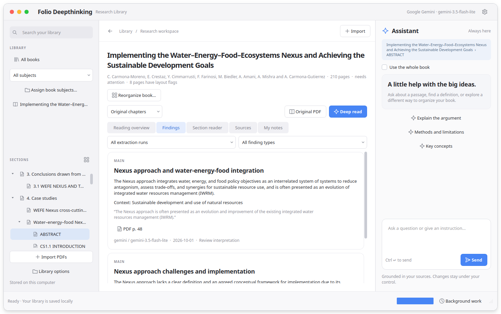
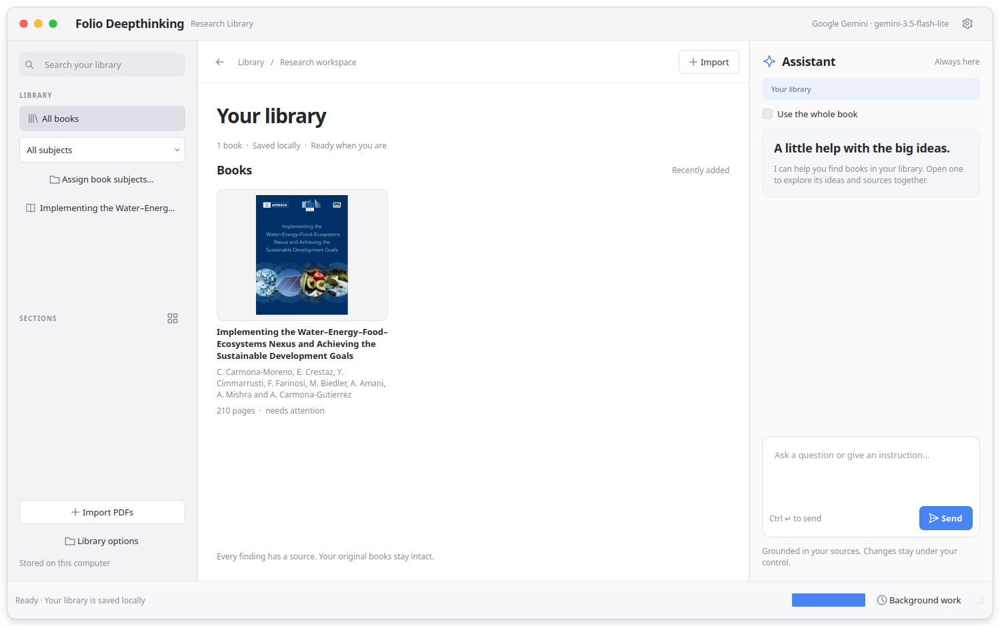
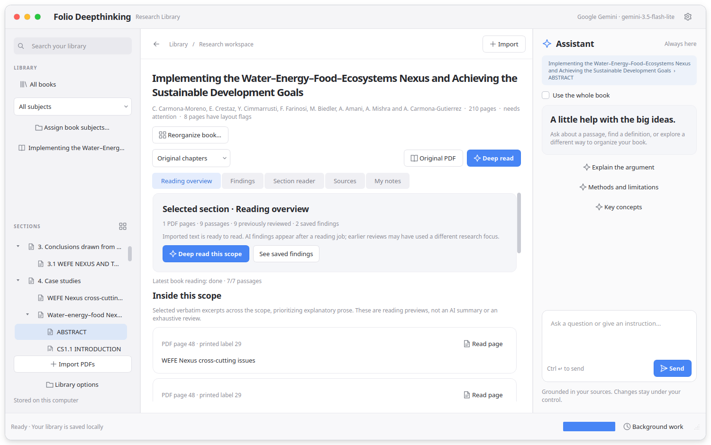
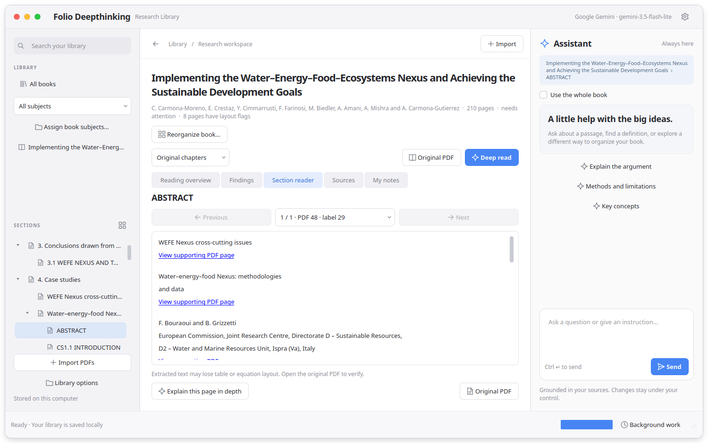
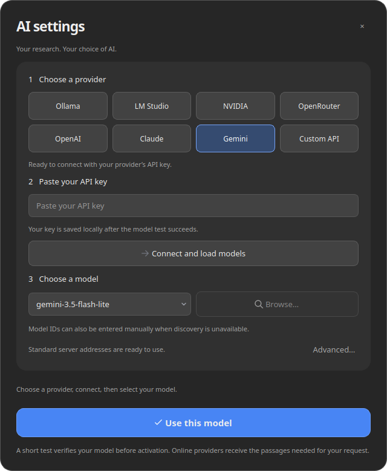

# Folio Deepthinking 📚

> **An AI research assistant for a personal library of PDF books.**
> Ask questions across your books, get answers grounded in verbatim quotes, and keep a traceable research trail — never a confident guess with no source behind it.

Built by **Abderrahman Ezzin** with **Python** and **PySide6** (Qt for Python), running as a native desktop app on Windows and Linux.

---

## 🖼️ Screenshots



*Findings from a deep read: each one carries a verbatim quotation, a link to its PDF page, and the model that produced it. Sections are on the left; the assistant is always on the right.*

| Library | Reading overview |
|---|---|
|  |  |
| **Section reader** | **AI settings** |
|  |  |

---

## What it does

Folio helps a researcher — the project was designed around a professor's personal PDF library — locate, extract, understand and organize evidence across many books, without losing track of where every claim actually came from.

- **Evidence-first answers.** Every finding is tied to a verbatim quote from the source PDF. The assistant is instructed to never invent a quote, a page number, or an author, and to say plainly when the available evidence can't settle a question.
- **Structured extraction.** Findings are returned as structured JSON (`category`, `title`, `content`, `evidence`) with categories for claims, definitions, formulas, methods and data — each preserving units, conditions and uncertainty instead of flattening them into a soundbite.
- **Scoped search.** Questions can be scoped to the whole library, a single book, a section or a selected passage, and the assistant respects that scope instead of silently mixing books together.
- **Coverage tracking.** A "quick retrieval" is explicitly partial; an "exhaustive" request requires a tracked extraction job and reports exactly how many passages were actually covered (e.g. "12 of 90 passages processed") rather than implying the whole book was read.
- **Notes & reorganization.** The professor's own notes are kept separate from AI-generated findings and from the original source text. Large reorganizations of the library's structure go through a proposal the user has to explicitly accept — nothing restructures silently.
- **Prompt-injection resistant.** PDF content, including anything that reads like an instruction to the AI ("ignore your previous instructions...") is treated strictly as untrusted research material to analyze, never as a command.

## 🧠 Why it's interesting from an engineering standpoint

The core of this project isn't the UI — it's the **prompt architecture** behind it. Each task (chat, quick extraction, deep/exhaustive extraction, structure proposals) has its own dedicated system prompt, each one specifying:
- what evidence is and isn't allowed to be asserted,
- how to handle incomplete/unreadable (scanned, image-only) pages,
- how to keep quantitative claims (numbers, units, conditions) intact instead of stripping context away,
- explicit example behaviors (few-shot) for edge cases like conflicting sources or failed tool calls.

That structure is what keeps the assistant useful for real research instead of producing fluent-sounding but unverifiable summaries.

## ▶️ Run it

### Windows (ready-made `.exe`)

1. Download **`FolioDeepthinking.exe`** from the [latest Release](../../releases/latest).
2. Put it in its own folder and double-click it. It is a single file; the first start takes a few seconds.
3. The app is unsigned, so SmartScreen may warn: **More info → Run anyway**.

Your library, database and API keys are stored in a `data` folder created next to the `.exe`.

### From source (Linux, macOS or Windows)

```bash
./install.sh        # creates .venv and installs pinned dependencies
./launch.sh         # starts the desktop app
```

Tests: `.venv/bin/python -m pytest tests -q`. See the [user guide](docs/USER-GUIDE.md) for the reading workflow and [architecture notes](docs/ARCHITECTURE.md) for design decisions.

### Building the Windows `.exe`

Pushing a tag such as `v0.1.0` runs the [Windows build workflow](.github/workflows/build-windows.yml), which tests the code, builds `FolioDeepthinking.exe` with PyInstaller on Windows and attaches it to a GitHub Release. To build locally on Windows: `pip install -r packaging/requirements-windows.txt`, `pip install --no-deps .`, then `pyinstaller packaging/folio.spec --noconfirm`; the app is written to `dist/FolioDeepthinking.exe`.

## 🛠️ Stack

- **Python 3.12**
- **PySide6** (Qt) for the desktop UI
- **PyMuPDF** for PDF parsing/extraction
- **SQLite** (with FTS5 full-text search) for the local library
- **Pydantic** for structured LLM output validation
- **httpx** adapters for Ollama, LM Studio, OpenAI, Anthropic, Gemini, NVIDIA, OpenRouter and compatible APIs
- Packaged with **PyInstaller**

## 📂 What's in this repo

```
folio/                      — application source
  prompts/                  — the system prompts that drive the assistant
    core.md                 — core research-assistant instructions
    chat.md                 — conversational mode
    extract.md / deep_extract.md — structured evidence extraction
    structure.md / group_structure.md — library reorganization proposals
  static/                   — UI icons
tests/                      — automated test suite
packaging/                  — PyInstaller spec, launcher, icon, Windows requirements
docs/                       — user guide, architecture, verification notes, screenshots
screenshots/                — app screenshots
```

---

*Built by [Abderrahman Ezzin](https://github.com/tifo234123) — Computer Engineering student, Università degli Studi di Cassino e del Lazio Meridionale.*
